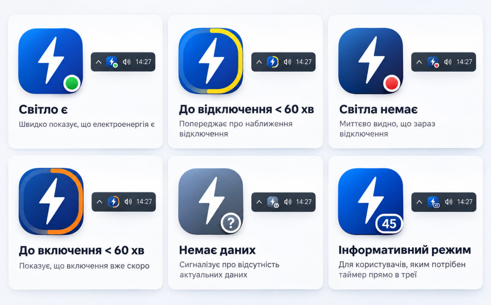
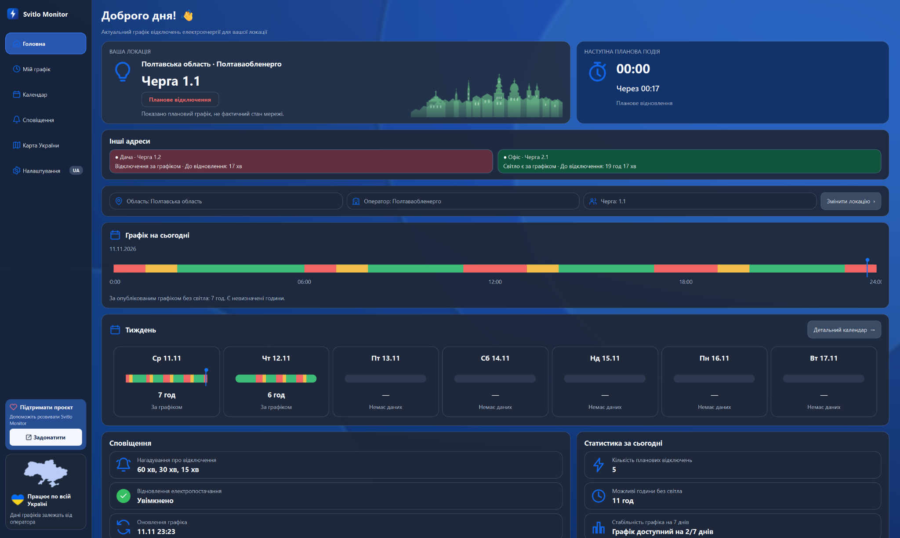
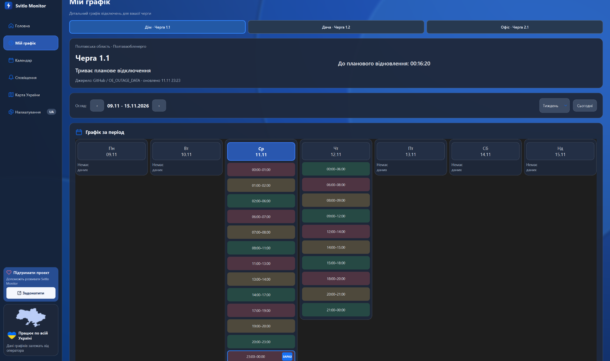
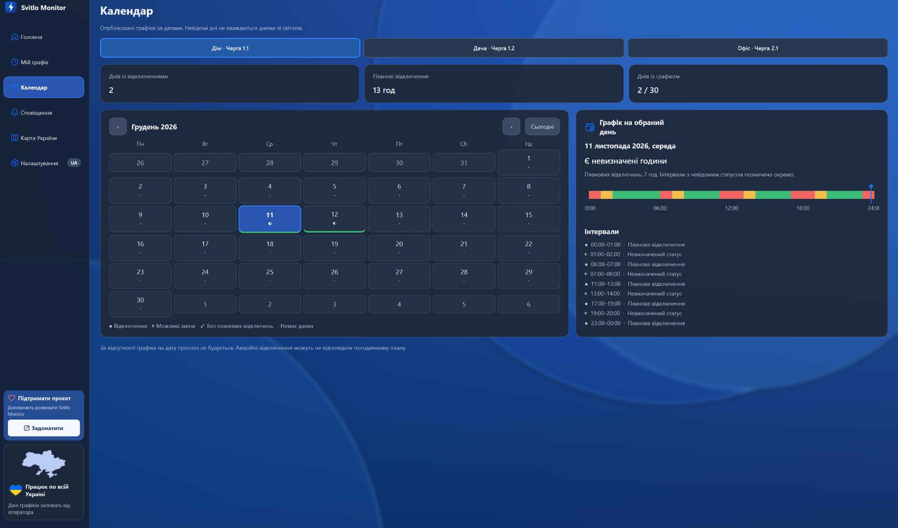
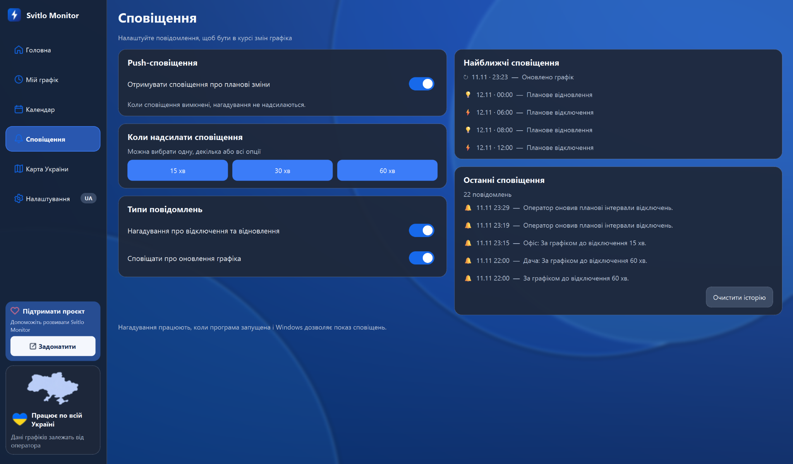
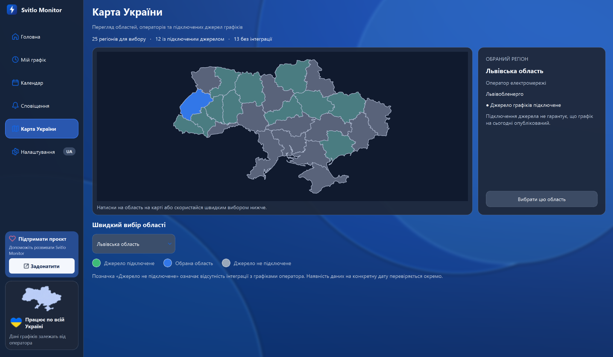
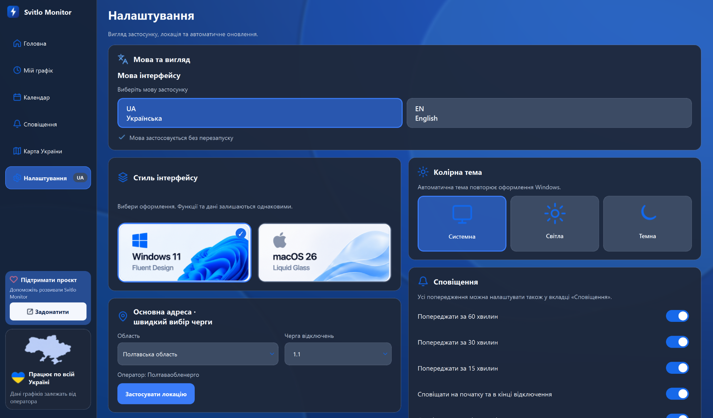
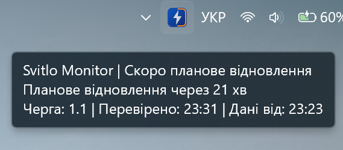
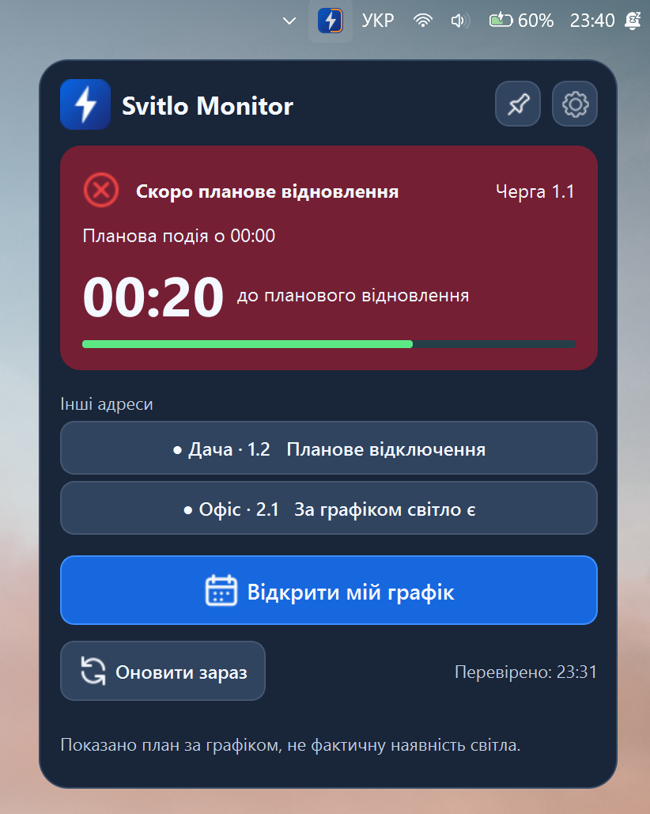
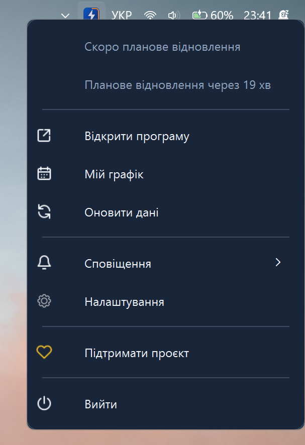

# Svitlo Monitor

Моніторинг графіків відключення електроенергії для Windows з підтримкою сповіщень, системного трею та кількох адрес.

## Завантаження

**Скачати останню версію для Windows:**

➡️ **[Завантажити Svitlo Monitor](https://github.com/Demetrius24/SvitloMonitor-Release/releases/latest/download/SvitloMonitor_Setup.exe)**

Або переглянути сторінку релізів:

📦 **[Усі релізи](https://github.com/Demetrius24/SvitloMonitor-Release/releases)**

---

## Що таке Svitlo Monitor

**Svitlo Monitor** — це застосунок для Windows, який допомагає стежити за графіками відключення електроенергії у зручному форматі.

Програма показує:

- поточний статус електропостачання за графіком,
- найближчу планову подію,
- графік на сьогодні,
- календар і тижневий перегляд,
- сповіщення про зміни,
- швидкий доступ через системний трей,
- підтримку кількох адрес,
- українську та англійську мови.

> **Важливо:** програма показує **плановий графік**, а не фактичну наявність світла в мережі.

---

## Основні можливості

- ✅ Моніторинг графіків відключення електроенергії
- ✅ Головний екран з поточним статусом
- ✅ Детальний перегляд графіка
- ✅ Календар за датами
- ✅ Push-сповіщення та нагадування
- ✅ Підтримка кількох адрес
- ✅ Карта України з доступними регіонами
- ✅ Робота через системний трей
- ✅ Швидке оновлення даних
- ✅ Українська та англійська локалізація
- ✅ Гнучкі налаштування інтерфейсу

## Статуси іконки в системному треї

Svitlo Monitor відображає стан електропостачання та найближчі планові події безпосередньо через іконку в системному треї Windows.

Колір індикатора допомагає швидко зрозуміти ситуацію, навіть не відкриваючи програму.

| Індикатор | Статус | Значення |
|---|---|---|
| 🟢 Зелений | **Світло є** | За графіком електропостачання доступне. |
| 🟡 Жовтий контур | **До відключення менше 60 хв** | Наближається планове відключення електроенергії. |
| 🔴 Червоний | **Світла немає** | За графіком триває планове відключення. |
| 🟠 Помаранчевий контур | **До відновлення менше 60 хв** | Наближається планове відновлення електропостачання. |
| ❔ Сірий | **Немає даних** | Актуальний графік недоступний або не опублікований. |
| 🔢 Таймер | **Інформативний режим** | Показує кількість хвилин до найближчої планової події безпосередньо на іконці. |

### Як це працює

Іконка змінюється залежно від актуального графіка та налаштувань програми. Для отримання детальної інформації можна натиснути на неї й переглянути найближчу подію, час до відключення або відновлення електропостачання.

> **Важливо:** індикатори відображають стан за опублікованим графіком, а не фактичну наявність електроенергії. Аварійні відключення та зміни, які ще не відображені в джерелі даних, можуть не враховуватися.
---

## Скріншоти

### Головний екран

### Мій графік

### Календар

### Сповіщення

### Карта України

### Налаштування

---

## Робота в системному треї

Svitlo Monitor працює у системному треї Windows і дає швидкий доступ до основних дій.

### Сповіщення при наведенні

### Вікно при лівому кліку

### Меню при правому кліку

---

## Встановлення

1. Перейдіть у розділ **[Releases](https://github.com/Demetrius24/SvitloMonitor-Release/releases)**.
2. Завантажте файл **`SvitloMonitor_Setup.exe`**.
3. Запустіть інсталятор.
4. Виконайте встановлення.
5. Відкрийте **Svitlo Monitor** та налаштуйте свою локацію / адресу.

---

## Системні вимоги

- **Операційна система:** Windows 10 / Windows 11
- **Підключення до інтернету:** потрібне для оновлення графіків
- **Сповіщення Windows:** мають бути дозволені в системі

---

## Підтримка проєкту

Якщо програма корисна для тебе — можеш підтримати її розвиток донатом ❤️

💙 **[Підтримати проєкт через monobank](https://send.monobank.ua/jar/415VV3ud4T)**

---

## Зворотний зв'язок

Якщо ти знайшов помилку або маєш ідею для покращення — створи issue в цьому репозиторії:

🛠 **[Повідомити про проблему / запропонувати ідею](https://github.com/Demetrius24/SvitloMonitor-Release/issues)**

---

## Оновлення

Усі нові версії програми публікуються тут:

🔄 **[Сторінка релізів](https://github.com/Demetrius24/SvitloMonitor-Release/releases)**

---

## Примітка

Дані графіків залежать від доступності та актуальності опублікованих джерел.  
Svitlo Monitor допомагає зручно відстежувати графік, але не може гарантувати фактичний стан електропостачання.
